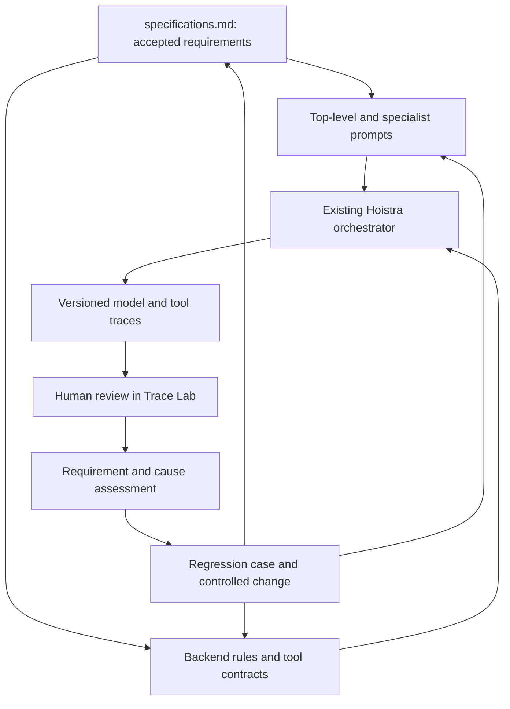

# Hoistra homework architecture and trace-feedback loop

Baseline architecture established 2026-10-24. This is an adaptation plan grounded in the available course files and current Hoistra code, not a claim that later homework integrations already exist.

## Four separate artifacts

| Artifact | Purpose | Current source |
|---|---|---|
| Product specification | Defines correct behavior and gives stable requirement IDs | `/specifications.md`, `/SPEC.md` pointer, referenced domain contracts |
| Model instructions | Guide decisions that the model makes | `svc-deepagents/src/agents/system_prompt.py`; `skills/`; specialist/router/planner/analyst/reviewer instruction sources |
| Executable enforcement | Selects routes and tools; enforces identity, validation, calculations and mutations | `svc-deepagents/src/` and downstream service code |
| Evaluation evidence | Establishes what happened under a known version and state | Homework cases/fixtures, actual tool records, traces, human notes, validated judges, regression results |

All service paths below are relative to `apps/backend/cafm-connector-service-final/`.



The trace/Trace Lab edges are the intended integration. The current isolated Hoistra runtime has not yet implemented that complete path.

## Where to edit a requirement

| Requirement group | Prompt/instruction source | Code/enforcement path | What to check after a change |
|---|---|---|---|
| ROUTE, SCOPE | system_prompt.py; skills/*; agent_router.py's routing prompt | orchestrator.py; agent_router.py; phase2_intents.py; session_workspace.py; single_door_flow.py | Same question across applicable flags; actual selected path and no unwanted tools |
| DATA, DOC | shared query-builder, UDR/doc-rag skills, evaluator prompts | udr_agent.py; udr_hybrid_tools.py; doc_rag_agent.py; udr_response_evaluator.py; DB/document services | Resolvers, rows/citations, counts, errors and state |
| WO | top-level WO sections; skills/wo-engine | wo_engine_agent.py and svc-work-order-management | Draft/confirm, IDs, authorization, transitions and approval state |
| MIG, FIIX, INGEST, CONNECT | top-level migration/Fiix instructions; skills/migration | migration_agent.py; fiix_agent.py; ingestion/session/single-door paths; mapper/connector services | Gate payloads, resume/continuation, duplicate uploads, actual writes |
| COMP | skills/compliance/*.md; compliance planner/analyst/reviewer prompt sources | compliance_router.py; compliance_* helpers; compliance_engine_agent.py; svc-operations-intelligence | Correct taxonomy/scopes/counts, selected topic docs, drafts/queue/verification |
| CONTRACT and formal FRs | skills/contract-performance; top-level scope and domain sections | contract_performance_agent.py and operations-intelligence contract implementation | Independent arithmetic, thresholds, defaults, approvals, source/audit/scheduler/UI |
| ENERGY | skills/energy-intelligence; scope instructions | energy_intelligence_agent.py and operations-intelligence energy implementation | Windows, units, period formula, provenance, actions and no dispatched WO |
| AUTH, STATE, HITL, TRACE, ERROR, OPS, UI | Only relevant explanatory model behavior; no prompt-based security enforcement | API/auth/session/tool code, checkpointer, tracing adapter, gateway/frontend | Real identity boundary, isolation, error propagation and correctly correlated traces |

No new agent is needed. Reuse the existing orchestrator and specialists. Do not add speculative business rules to the prompt to compensate for incomplete tools or an undefined permission policy.

## How the actual prompts are assembled

1. `src/agents/system_prompt.py:SYSTEM_PROMPT` holds the editable top-level template; `build_system_prompt(extra_context)` injects routing keywords and the generated skill index, then optional context.
2. `src/agents/skills.py:agent_system_prompt(agent, extra)` combines the shared skill, optional contract and domain skill. `meta_tools.py` binds these to specialists.
3. Compliance can compose selected `skills/compliance/*.md` via `compliance_router.py`; some paths use distinct planner, summarizer, analyst and reviewer prompts in `orchestrator.py`/helpers. Hash all prompt-bearing code and documents, not only the top-level template.
4. Dedicated shortcut routes can bypass the main ReAct prompt. For each actual model call, eventual tracing must record the prompt it really received, selected skill documents and role in the workflow.
5. Skill loading uses process caches. Editing a source file does not update a previously built Docker image. Rebuild/recreate after a prompt/code change, then confirm source hashes and capture a new baseline.

## Version contract for future traces

| Field | Meaning |
|---|---|
| `spec_version`, `spec_hash` | Human contract revision and SHA-256 of canonical specification bytes |
| `prompt_template_hash` | SHA-256 of the top-level template |
| `rendered_base_prompt_hash` | Exact top-level rendered prompt without per-request context |
| `effective_prompt_hash` | Exact effective system instruction at an individual model call, after context/skill composition; future instrumentation must compute this |
| `behavior_bundle_hash` | Offline fingerprint of rendered base/specialist snapshots, instruction/code files, model and flags |
| `code_revision`, `working_tree_dirty`, image ID | Build provenance, including uncommitted changes; Git HEAD alone is insufficient |
| scenario/session/trace IDs | Distinct experiment, conversation and observed execution identities |
| fixture revision, reset ID, model/provider, flags | Conditions needed to reproduce expected and observed behavior |

`export-prompt-baseline.py` captures an **offline configuration baseline** from the running container. It does not instrument requests, export Langfuse traces, include live runtime context or reproduce question-selected compliance prompts. It writes immutable JSON snapshots and refuses to overwrite an existing destination. Snapshot provenance is explicitly a fresh renderer reading the container files; it cannot prove a long-lived process's caches match a live call. Per-call model input spans remain the eventual source of truth.

Run from the repository root:

```bash
python3 homework/module-1/export-prompt-baseline.py
```

Review baselines before committing. They contain source-derived instructions but no API keys, user messages, database rows or runtime context. Keep actual model input spans private/redacted according to their contents. Add per-request `hoistra.*` attributes in the authenticated endpoint and each model/tool span in the tracing stage; use the adapter to map them into Trace Lab's supported fields. Merely adding a spec file or a Langfuse container does not implement this.

## Alignment with the course files available locally

| Stage | What the checked sources require/support | Hoistra adaptation / current status |
|---|---|---|
| HW1 handout | Read supplied SPEC, complete tool contracts, ≥10 manual conversations, compare spec and prompt, evidence-driven minimal prompt revision or explanation for no revision | Canonical spec and mapped existing agent; preserve sample evidence. No requirement to regenerate an already existing agent from scratch |
| HW2 handout | Authenticated sessions/message endpoint, OTel model/tool spans, root prompt version and scenario/identity metadata | Hoistra HTTP routes exist, but authenticated caller binding and Langfuse/OTel integration remain pending |
| HW3 handout | Synthetic coverage/challenge data, pilot/human confirmation, fixed final model, fresh identifiers and fixture resets, export complete traces | Build Hoistra fixtures and scenario schema against accepted spec; do not copy Cartwheel order IDs or seed into prompts |
| Analysis workflow used for HW4/5 | Human open/axial coding, stable notes/taxonomy, human labels, judge validation and corrected prevalence | Later adapt trace normalization and UI to Hoistra. Human decides labels; machine suggestions are not confirmed modes |
| HW6 eval_cases/README.md | 30 cases: 20 regressions and 10 capability tests; five baseline runs; coverage of final modes; no evaluation leakage | Preserve equivalent Hoistra state/checks/judges and accepted requirement IDs; not implemented by this document |
| Later replay/monitoring/security/optimization code | Existing replay harness and monitoring/security/controlled-optimization support | Adapt interfaces only when doing those stages; preserve baseline/test separation and version artifacts. Exact later handout requirements are not claimed without the handouts |

Only module-1 HW1–HW3 handouts are present in the inspected local homework folder. Later-stage details above come from the actual analysis skill, eval README and supporting code, not invented HW4–HW9 handouts.

## Feedback loop to follow during live coding

1. Freeze source/config/prompt baseline and initial fixtures for the run. Link each scenario to a requirement and expected outcome before reading the model answer.
2. Collect actual model/tool execution with original version metadata; verify trace correlation and authorization context.
3. The human records what failed. Link the observation to the requirement and evidence. Keep invalid scenarios/environment problems separate.
4. If no accepted requirement defines correctness, the owner makes a specification decision. Otherwise choose prompt, code/tool, routing, or environment based on evidence.
5. Create the reproducer/regression case before the fix. Change the smallest relevant source; do not paste the held-out example into the prompt.
6. Record the spec/prompt/code change and reason; rebuild/restart, capture a new baseline, repeat the reproducer and relevant regressions under known state.
7. Preserve before/after outputs, failure taxonomy/label versions and evaluation split. Do not erase old failure evidence when a test starts passing.

For Homework 1, the required authoring procedure is
`homework/module-1/hw1-expected-outcome-workflow.md`. The authoritative row-level
linkage is `homework/module-1/hw1-case-spec-mapping.json`; validate it with
`python3 homework/module-1/validate_hw1_spec_evidence.py` before committing an
expected-outcome, specification, prompt or evidence change. This check enforces
traceability but does not load the full specification into the runtime model.

## Change record shape

`homework/change-log.jsonl` holds change events with change ID, timestamp, requirement IDs, evidence references, change target, rationale, spec versions and baseline references. A proposed observation may have no accepted failure mode and must say so. Never manufacture a human approval or label.

For the current C01 route-metadata observation, preserve it as an investigation item. Do not edit the top-level prompt merely because the answer's metadata says `fiix_sync`; inspect routing and trace construction first. No further sample questions are needed to establish this architecture.

## Accepted role policy — v0.2.0

The owner-defined role matrix is now in canonical specification Section 3 (General User, Portfolio Manager, Property Manager, Compliance Officer). AUTH-03–AUTH-09 map these grants to future authorization checks. Backend enforcement is not implemented by this documentation change. Preserve the old v0.1.0 baseline; capture a separate v0.2.0 snapshot with the same unchanged behavior bundle. Resolve residual identity/email/ingestion/vendor-block details before implementing affected workflows.

## Usage-policy update — v0.4.0

Canonical Section 3.8 now defines informational usage reports, four-role recipient scopes, weekly digest and immediate action-needed/failure alerts. Section 3.5 separates OPEN-01–09 product decisions from implementation backlog. No scheduler, email send or usage collection was enabled by this documentation update.
